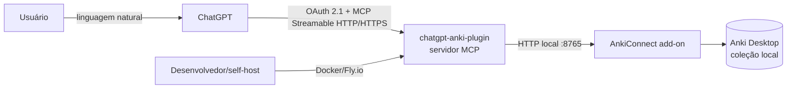
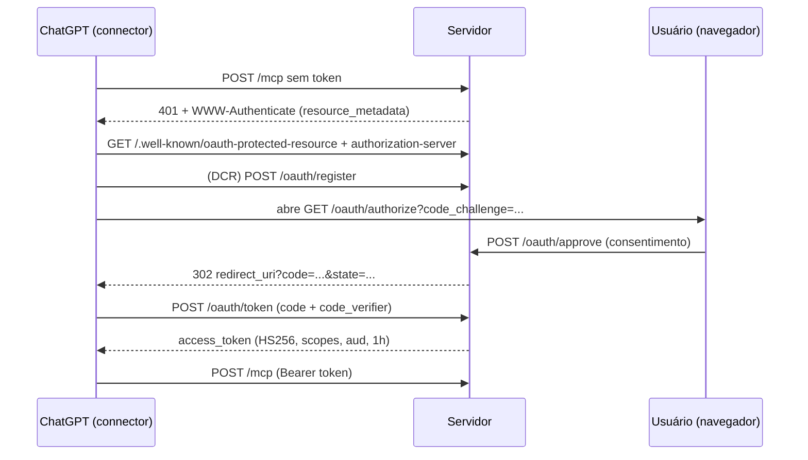
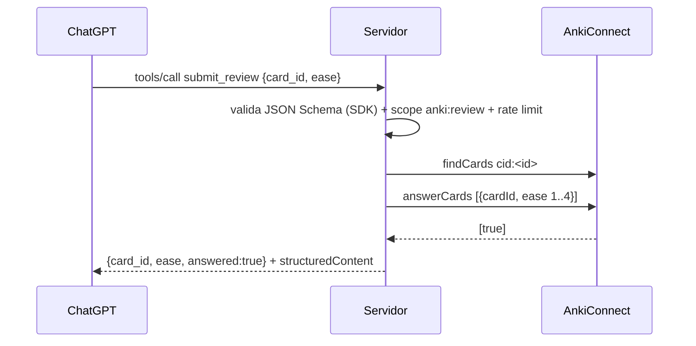

# 03 — Arquitetura

## Contexto (C4 nível 1)



**Fronteiras explícitas:**

- O servidor **não** fala com o AnkiWeb (sem API pública; ver ADR-0001).
- O servidor **não** persiste coleção, credenciais do AnkiWeb ou conteúdo de cartões.
- O operador do servidor é o dono da coleção (modelo single-tenant v0.1 — ADR-0008).

## Contêineres (C4 nível 2)

| Contêiner | Tecnologia | Responsabilidade |
|:---|:---|:---|
| `chatgpt-anki-mcp` | Node 22 + TypeScript (ESM) | HTTP + MCP + OAuth + tools + widgets |
| `AnkiConnect` | Add-on Anki (externo) | API local da coleção (v6) |
| Anki Desktop | App do usuário (externo) | Coleção/scheduler |

## Componentes (C4 nível 3)

```mermaid
flowchart TB
    subgraph src/app.ts
        HTTP[Roteador HTTP: /health /ready /mcp /oauth/* /.well-known/* /widgets/*]
        AUTH[Middleware Bearer → AuthInfo]
    end
    subgraph src/mcp
        SRV[buildMcpServer<br/>registro das 15 tools]
        SDK[StreamableHTTPServerTransport<br/>stateless + JSON mode]
        OAS[OAuthService: codes + PKCE]
        TOK[Tokens HS256]
        RL[FixedWindowLimiter]
    end
    subgraph src/tools
        REG[registry (contratos Zod)]
        DEF[decks/cards/notes/review/models]
        ERR[toErrorPayload]
    end
    subgraph src/anki
        GW[AnkiGateway]
        ADP[Decks/Cards/Notes/Review adapters]
        CLI[AnkiConnectClient]
        MOCK[MockAnkiConnect (demo/test)]
    end
    HTTP --> AUTH --> SDK --> SRV --> DEF --> GW
    DEF --> ERR
    GW --> ADP --> CLI
    OAS --> TOK --> AUTH
    RL --> SRV
    HTTP --> OAS
    CLI -.->|ANKI_BACKEND=mock| MOCK
```

## Camadas e regras de dependência

```
src/domain      ← entidades + mappers wire→domínio (anti-corruption layer)
src/anki        ← adapters do AnkiConnect (client, decks, cards, notes, review, mock)
src/tools       ← contratos Zod + handlers + taxonomia de erro + registry
src/mcp         ← protocolo (SDK), auth, rate limit, servidor
src/infra       ← config validada, logger, telemetria
src/app.ts      ← roteador HTTP (única entrada de rede)
src/index.ts    ← bootstrap (config → backend → app → listen → shutdown)
src/widgets     ← HTML/CSS/JS estáticos (Apps SDK)
```

Regra: dependências fluem para **baixo** (`tools → anki → domain`); `mcp` orquestra;
nada em `anki`/`domain` importa `mcp` ou `app`.

## Fluxo 1 — Autorização (OAuth 2.1)



## Fluxo 2 — Chamada de tool (ex.: revisão)



## Modelo de dados (JSON das tools)

Entidades de domínio em `src/domain/types.ts`; JSON público (snake_case) em
`src/tools/schemas.ts` e contrato completo em `05-tools-mcp.md`. Conversões
centralizadas em `src/tools/mappers.ts`.

## Modelo de erro

| Camada | Tipo | Mapeamento |
|:---|:---|:---|
| HTTP/auth | `HttpError`, `TokenError` | 401/403/413/400 + `WWW-Authenticate` |
| OAuth | `OAuthError` | `{error, error_description}` (RFC 6749) |
| Anki | `AnkiTransportError`/`AnkiConnectError`/`AnkiNotFoundError`/`AnkiConflictError` | `ANKI_UNAVAILABLE`/`ANKI_ERROR`/`NOT_FOUND`/`CONFLICT` |
| Tools | `ToolError` | `VALIDATION_ERROR`, `FORBIDDEN`, `RATE_LIMITED`, `INTERNAL` |
| Protocolo | SDK `McpError` | `isError=true` com mensagem de validação nomeando a tool |

## Configuração (matriz de env)

Fonte única: `src/infra/config.ts` (Zod) + `.env.example` documentado. Destaques:

| Variável | Default | Nota de arquitetura |
|:---|:---|:---|
| `ANKI_BACKEND` | `connect` | `mock` liga o emulador sintético in-process |
| `PUBLIC_BASE_URL` | `http://localhost:8080` | define `issuer`/`aud` dos tokens |
| `TOKEN_SECRET` | dev placeholder | **obrigatório** em produção (boot falha sem ele) |
| `DEFAULT_SCOPE` | read+write+review | `anki:admin` nunca é default |
| `AUTH_REQUIRED` | `true` | `false` só em dev local |
| `MCP_DEV_TOKEN` | — | token fixo de desenvolvimento (ignora OAuth) |

## Decisões (ver ADRs)

- ADR-0001 estratégia de acesso ao Anki (AnkiConnect primário)
- ADR-0002 stack e transporte (TS/Node + MCP SDK + JSON mode)
- ADR-0003 OAuth 2.1 + PKCE + scopes + tokens stateless
- ADR-0004 stateless/sem persistência + mock sintético
- ADR-0005 Zod como fonte única de contrato
- ADR-0006 estratégia de testes e gates de cobertura
- ADR-0007 deploy Docker/Fly + observabilidade
- ADR-0008 single-tenant primeiro (roadmap multi-tenant)

## Riscos arquiteturais assumidos

1. **AnkiConnect precisa do Anki Desktop rodando** — modo de falha explícito (`ANKI_UNAVAILABLE` + `/ready`); headless é evolução futura (ADR-0001).
2. **Scheduler fora do nosso controle** — `submit_review` depende de `answerCards` (recentes); erros de versão mapeados com hint.
3. **Instância única por usuário** — limita a listagem pública do app (ADR-0008); mitigação planejada com config cifrada por usuário.
