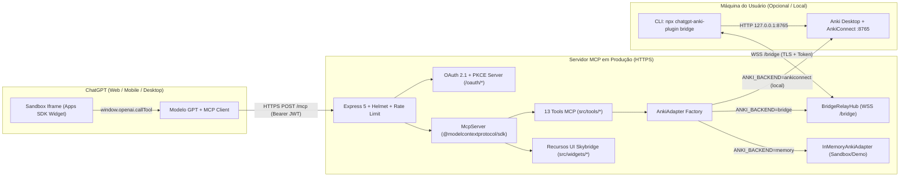

# Arquitetura e Dossiê Técnico Anki (`docs/03-arquitetura.md`)

## 1. Dossiê de Fontes Oficiais Anki

### 1.1 Ecossistema Anki, Coleção SQLite e Formato `.apkg` / `.colpkg`

* **Manual Oficial do Anki**: <https://docs.ankiweb.net/>
* **Busca Nativa (`searching.html`)**: <https://docs.ankiweb.net/searching.html>
* **Servidor de Sincronização Auto-Hospedado (`sync-server.html`)**: <https://docs.ankiweb.net/sync-server.html>
* **Termos de Serviço do AnkiWeb**: <https://ankiweb.net/account/terms>
* **Add-on AnkiConnect (código `2055492159`)**: <https://foosoft.net/projects/anki-connect/> e repositório oficial <https://git.sr.ht/~foosoft/anki-connect>
* **Algoritmo FSRS (Free Spaced Repetition Scheduler)**: <https://github.com/open-spaced-repetition/fsrs4anki> / integrado nativamente ao Anki 23.10+.

#### Modelo de Dados do Anki

1. **Note (Nota)**: unidade de conhecimento composta por um **Note Type / Model** (ex.: `Basic`, `Cloze`), um dicionário de **Fields** (`{ Front, Back }`) e uma lista de **Tags**. Na tabela `notes` do SQLite (`collection.anki2` / `collection.anki21`), os campos são armazenados concatenados por `0x1f` (`\x1f`), mas o AnkiConnect os expõe já estruturados por nome.
2. **Card (Cartão)**: instância agendável gerada a partir de uma Nota e um Template (`ord`). Um cartão possui:
   * `cardId` (epoch ms de criação), `noteId`, `deckName`, `modelName`;
   * `type`: `0 = new`, `1 = learning`, `2 = review`, `3 = relearning`;
   * `queue`: `-3/-2 = buried`, `-1 = suspended`, `0 = new`, `1 = learning`, `2 = review`, `3 = day learn`;
   * `interval` (`ivl`), `factor` (ease em permil, ex.: `2500` = 250%), `reps` (total de revisões), `lapses` (total de esquecimentos), `due`.
3. **Deck (Baralho)**: agrupador lógico de cartões com suporte a hierarquia separada por `::` (ex.: `Medicina::Clínica::Nefrologia`).
4. **Review / Ease (Avaliação)**: tanto no agendador **SM-2** quanto no **FSRS**, a resposta a um cartão usa 4 botões padronizados:
   * `1` = **Again** (Errei / Lapso)
   * `2` = **Hard** (Difícil)
   * `3` = **Good** (Bom)
   * `4` = **Easy** (Fácil)
5. **Pacotes `.apkg` e `.colpkg`**: arquivos ZIP contendo a base SQLite (`collection.anki21` / `collection.anki21b` comprimida com Zstandard) e um arquivo JSON `media` mapeando arquivos de mídia numerados.

---

### 1.2 Protocolo AnkiConnect (Versão 6)

O AnkiConnect expõe um servidor HTTP local em `http://127.0.0.1:8765`. Todas as chamadas usam `POST /` com JSON:

```json
{
  "action": "deckNamesAndIds",
  "version": 6,
  "key": "opcional-api-key",
  "params": {}
}
```

E retornam sempre o envelope:

```json
{
  "result": { "Default": 1 },
  "error": null
}
```

#### Mapeamento Exato de Ações AnkiConnect Utilizadas pelo Projeto

| Ação AnkiConnect | Parâmetros | Retorno | Uso nas Tools MCP |
|:-----------------|:-----------|:--------|:------------------|
| `version` | `{}` | `number` (`6`) | Healthcheck e diagnóstico |
| `deckNamesAndIds` | `{}` | `Record<string, number>` | `list_decks`, `get_deck`, `create_deck` |
| `getDeckStats` | `{ decks: string[] }` | `Record<deckId, { deck_id, name, new_count, learn_count, review_count, total_in_deck }>` | `list_decks`, `get_deck`, `get_stats` |
| `getDeckConfig` | `{ deck: string }` | Objeto de configuração do grupo de opções | `get_deck` |
| `createDeck` | `{ deck: string }` | `number` (`deckId`) | `create_deck`, `update_deck`, `create_note` |
| `changeDeck` | `{ cards: number[], deck: string }` | `null` | `update_deck` |
| `deleteDecks` | `{ decks: string[], cardsToo: true }` | `null` | `delete_deck`, `update_deck` |
| `findCards` | `{ query: string }` | `number[]` (`cardIds`) | `search_cards`, `get_deck`, `get_due_cards`, `get_stats` |
| `cardsInfo` | `{ cards: number[] }` | `AnkiCardInfoRaw[]` | `search_cards`, `get_card`, `get_due_cards`, `submit_review` |
| `findNotes` | `{ query: string }` | `number[]` (`noteIds`) | `create_note` (checagem), buscas |
| `notesInfo` | `{ notes: number[] }` | `AnkiNoteInfoRaw[]` (campos `{ value, order }`) | `get_card`, `update_note`, `delete_note` |
| `modelNames` | `{}` | `string[]` | `create_note` |
| `modelFieldNames` | `{ modelName: string }` | `string[]` | `create_note` (validação de campos) |
| `addNote` | `{ note: { deckName, modelName, fields, tags, options } }` | `number` (`noteId`) | `create_note` |
| `updateNoteFields` | `{ note: { id, fields } }` | `null` | `update_note` |
| `addTags` / `removeTags` | `{ notes: number[], tags: string }` | `null` | `update_note` |
| `deleteNotes` | `{ notes: number[] }` | `null` | `delete_note` |
| `answerCards` | `{ answers: [{ cardId: number, ease: 1\|2\|3\|4 }] }` | `boolean[]` | `submit_review` |
| `getReviewsOfCards` | `{ cards: number[] }` | `Record<cardId, ReviewEntry[]>` | `get_card` |
| `getNumCardsReviewedToday` | `{}` | `number` | `get_stats` |
| `getNumCardsReviewedByDay` | `{}` | `[string, number][]` | `get_stats` |

> **Nota técnica importante sobre `update_deck` (renomeação):** o AnkiConnect v6 **não possui** uma action `renameDeck`. Para permitir renomear baralhos via `update_deck({ deckName, newName })`, o adaptador executa uma migração segura e documentada: `createDeck(newName)` → `findCards("deck:\"deckName\"")` → `changeDeck(cards, newName)` → `deleteDecks([deckName], cardsToo: true)` (apenas após confirmar que todos os cartões foram movidos).

---

### 1.3 Sintaxe Nativa de Busca do Anki (`searching.html`)

O Anki interpreta queries avançadas diretamente em `findCards` e `findNotes`:

* `deck:"Medicina::Cardiologia"` — filtra por baralho ou sub-baralho.
* `tag:anatomia` ou `tag:none` — filtra por tag.
* `is:due`, `is:new`, `is:learn`, `is:review`, `is:suspended`, `is:buried` — filtra por estado de agendamento.
* `prop:ivl>=21`, `prop:lapses>3`, `prop:ease<2.0`, `prop:due<=0` — propriedades numéricas do cartão.
* `rated:1` (revisados hoje), `rated:7:1` (respondidos com *Again* nos últimos 7 dias), `added:7` (criados nos últimos 7 dias).
* `Front:*insuficiência*` — busca restrita a um campo específico.
* Operadores booleanos: espaço (AND implícito), `OR`, `-` (NOT, ex.: `-is:suspended`), parênteses `(tag:a OR tag:b)`.

O módulo `src/anki/search.ts` oferece validação sintática preventiva (aspas desbalanceadas, parênteses não fechados) e construtores seguros para escapar nomes de baralhos com espaços ou caracteres especiais.

---

## 2. Arquitetura em Camadas do Sistema



### 2.1 Descrição dos Módulos (`src/`)

* `src/domain/` — Entidades puras (`Deck`, `Note`, `Card`, `Review`, `CollectionStats`) e classes de erro tipadas (`AnkiPluginError`, códigos padronizados, dicas acionáveis).
* `src/anki/` — Interface `AnkiAdapter` (`adapter.ts`), cliente HTTP `AnkiConnectAdapter` (`anki-connect-adapter.ts`), adaptador em memória `InMemoryAnkiAdapter` (`memory-adapter.ts`), adaptador de túnel reverso `BridgeRelayAdapter` (`bridge-adapter.ts`), e utilitários de busca (`search.ts`) e revisão (`review.ts`).
* `src/mcp/` — Criação do `McpServer` (`server.ts`), transporte Streamable HTTP (`http-server.ts`) e servidor OAuth 2.1 com PKCE, Dynamic Client Registration e verificação de escopos (`src/mcp/auth/*`).
* `src/tools/` — Um arquivo por tool (`list-decks.ts`, `get-deck.ts`, `create-deck.ts`, `update-deck.ts`, `delete-deck.ts`, `search-cards.ts`, `get-card.ts`, `create-note.ts`, `update-note.ts`, `delete-note.ts`, `get-due-cards.ts`, `submit-review.ts`, `get-stats.ts`) + `context.ts` e `index.ts`.
* `src/widgets/` — Templates HTML/JS autocontidos compatíveis com `text/html+skybridge` e `window.openai`.
* `src/infra/` — Configuração validada por Zod (`config.ts`), logger estruturado (`logger.ts`) e coletor de métricas (`telemetry.ts`).
* `src/bridge/` — CLI `anki-bridge` que conecta o AnkiConnect local ao servidor MCP remoto via WebSocket.
